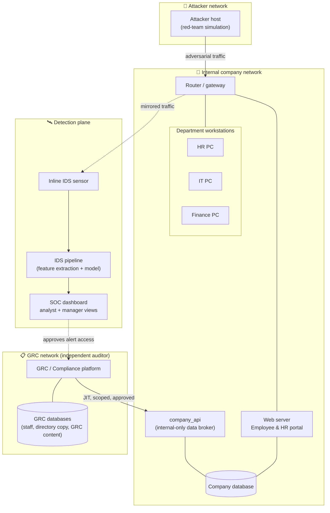
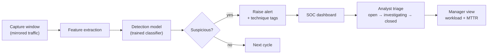
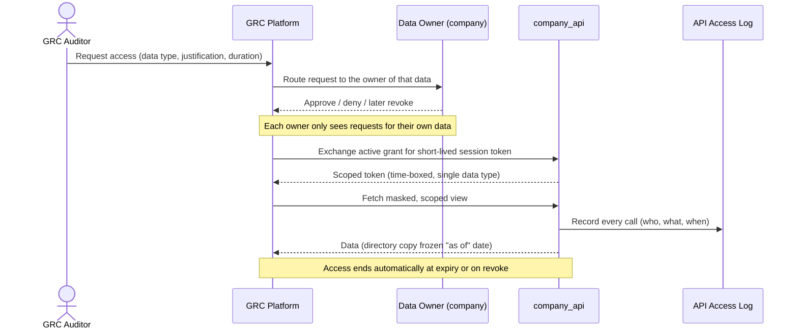

# Lateral Movement Detection Lab

> A containerized cyber range that simulates a small enterprise network, a red-team attacker, an inline intrusion-detection system (IDS) feeding a SOC, and an **independent GRC / compliance platform** that audits the company through just-in-time, least-privilege data access.

This repository is an **informational showcase** of a senior capstone project. It documents the architecture, design decisions, and tooling of the lab. It intentionally contains **no source code, configuration, credentials, or data** from the live environment.

---

## Table of Contents

- [Overview](#overview)
- [What the lab demonstrates](#what-the-lab-demonstrates)
- [System architecture](#system-architecture)
- [Components](#components)
- [Detection pipeline](#detection-pipeline)
- [GRC platform &amp; just-in-time access](#grc-platform--just-in-time-access)
- [Frameworks mapped](#frameworks-mapped)
- [Tools &amp; technologies](#tools--technologies)
- [Engineering highlights](#engineering-highlights)
- [Learning outcomes](#learning-outcomes)
- [Disclaimer](#disclaimer)

---

## Overview

The lab recreates the moving parts of a real organization so that **detection and governance** can be studied end-to-end:

- A **segmented company network** with departmental workstations, a web/HR portal, and backing databases.
- A contained **attacker host** used to generate adversarial traffic for the blue team to detect.
- An **inline IDS** that mirrors internal traffic into a detection pipeline, raising alerts into a **SOC dashboard**.
- An **independent GRC (Governance, Risk &amp; Compliance) platform** that audits the company the way an external auditor would — with **no standing access** to company data, only short-lived, approved, scoped grants.

Everything runs locally through **Docker Compose** on isolated virtual networks. The emphasis throughout is the **defensive** side: observing lateral-movement behavior, triaging alerts, and evidencing compliance — not offensive tradecraft.

---

## What the lab demonstrates

| Theme | Demonstrated by |
|---|---|
| Network segmentation | Separate internal / attacker / GRC Docker networks with a routing boundary |
| Lateral-movement **detection** | Inline IDS → feature pipeline → alerting into a SOC console |
| SOC operations | Analyst and manager dashboards, alert triage, workload &amp; MTTR views |
| Least-privilege data sharing | GRC platform pulls company data **just-in-time**, per auditor, per data type |
| Auditor independence | Company staff own and approve access to their own data; auditors cannot self-serve |
| Compliance automation | IDS alert outcomes mapped to security-control effectiveness |
| Secure engineering | Role-based access control, scoped API tokens, segregated database accounts |

---

## System architecture

> Trust boundaries are explicit: the attacker lives on its own network, the detection plane only *observes*, and the GRC platform is fully external to the company — it never touches the company database directly.

---

## Components

| Component | Role | Audience |
|---|---|---|
| **Company network** | Routed internal network with departmental workstations and a web/HR portal | Company staff |
| **Company database** | System of record for the simulated company | Company apps |
| **company_api** | Internal-only broker that exposes *masked, scoped* views of company data to approved consumers | GRC platform |
| **Attacker host** | Generates adversarial / lateral-movement-style traffic for the blue team to catch | Red team |
| **Inline IDS + pipeline** | Captures mirrored traffic, extracts features, scores it, and raises alerts | Detection plane |
| **SOC dashboard** | Alert triage for analysts; workload, assignment, and MTTR aggregation for the SOC manager | SOC |
| **GRC / Compliance platform** | Independent audit platform: frameworks, controls, risk, evidence, governance | External auditors |
| **GRC databases** | Segregated stores for GRC staff logins, a *frozen copy* of the employee directory, and all GRC content | GRC platform only |

---

## Detection pipeline

The detection plane is a continuous, sequential loop: capture a window of mirrored traffic, turn it into features, score it, and surface anything suspicious to the SOC.

**Design notes**

- The pipeline runs as a **sequential cycle** (capture → process → brief pause), so detection latency is a *cycle time*, not an instantaneous guarantee — a limitation documented honestly in the project's requirements review rather than overstated.
- Alerts carry **technique tags** so analysts get context, and the SOC manager view aggregates per-analyst open / investigating / closed counts and mean-time-to-resolution.
- Access to the raw alert feed by outside parties (the GRC auditors) is **gated** behind SOC-manager approval — detection data is not public even inside the lab.

---

## GRC platform &amp; just-in-time access

The compliance platform is deliberately modeled as a **separate organization** auditing the company. It has **no database access to the company and no standing access to company data**. Every piece of company data it uses is obtained **just-in-time**, per auditor and per data type, and each kind of data has a **data owner** at the company who must approve the request.

**Why this is interesting**

- **Least privilege over time:** grants are short-lived and renewed automatically only while valid — not permanent.
- **Separation of duties:** the SOC manager approves access to alerts; the HR manager approves access to the employee directory. Auditors can never approve their own access.
- **Evidence integrity:** the employee directory is copied as a **point-in-time snapshot** ("as of" a date), so audit evidence is stable even if the live company data later changes.
- **Full accountability:** every API call is written to an access log — the kind of control a privacy regulation (e.g. PDPL) would expect.

---

## Frameworks mapped

The GRC platform organizes controls and evidence against widely used security and governance frameworks:

- **NIST Cybersecurity Framework (CSF)** — control families mapped to live detection outcomes
- **ISO/IEC 27001** — Annex A controls, with network segregation and logging emphasized for a lateral-movement context
- **NCA Essential Cybersecurity Controls (ECC)** — the Saudi national baseline
- **MITRE ATT&amp;CK** — technique tagging on alerts for shared blue-/red-team vocabulary

A core idea in the design: **Detect** controls are judged effective when alerts fire *and* are triaged within SLA, while an alert against a **Protect** control is treated as evidence that prevention *failed* — a more honest model than "a closed ticket means the control works."

---

## Tools &amp; technologies

| Category | Technologies |
|---|---|
| **Containerization** | Docker, Docker Compose, isolated bridge networks, named volumes |
| **Backend / apps** | Python (Flask), server-rendered dashboards |
| **Data** | MySQL 8 (segregated databases &amp; least-privilege DB accounts), SQL views for data masking |
| **Detection** | Traffic capture, feature engineering, a trained classification model, an alerting pipeline |
| **Web / company tier** | PHP employee &amp; HR portals, a reverse-proxy / routing boundary |
| **Security patterns** | Role-based access control (RBAC), scoped &amp; time-boxed API tokens, just-in-time access, data-owner approval workflows, access logging |
| **Frameworks** | NIST CSF, ISO/IEC 27001, NCA ECC, MITRE ATT&amp;CK |

---

## Engineering highlights

- **Defense-in-depth by design:** attacker, company, detection, and audit planes are separated at the network level, not just logically.
- **Honest requirements engineering:** the project's own requirements review re-examined and *corrected* overstated guarantees (e.g. detection latency, SOC role capabilities) against the real code rather than the spec.
- **Security-hardening iterations:** the GRC module went through structured reviews covering password hashing, fail-closed authorization, segregated database accounts, constant-time token checks, data-masking views, and protection against a sync job wiping the directory.
- **Realistic GRC semantics:** residual vs. inherent risk, risk-acceptance workflows with expiry, immutable evidence snapshots with hashing, and an audit trail of every change.

---

## Learning outcomes

Through building and iterating on this lab, the project explores:

1. How lateral-movement behavior looks on the wire and how an inline sensor can surface it.
2. How a SOC turns raw alerts into triaged, measurable work (MTTR, workload balancing).
3. How to share sensitive data across organizational boundaries **without** granting standing access — using approval, scoping, time-boxing, and logging.
4. How security controls map to recognized frameworks, and how to measure control *effectiveness* honestly from operational signals.
5. How to review your own system critically and separate "what the spec claims" from "what the code actually does."

---

## Disclaimer

This is an **educational, self-contained lab** built for a senior capstone. It runs only on isolated local Docker networks and is intended for **defensive** study — detection engineering, SOC operations, and compliance/GRC. It is **not** a tutorial for conducting attacks, and no live data, credentials, or exploit material is included in this showcase repository.
